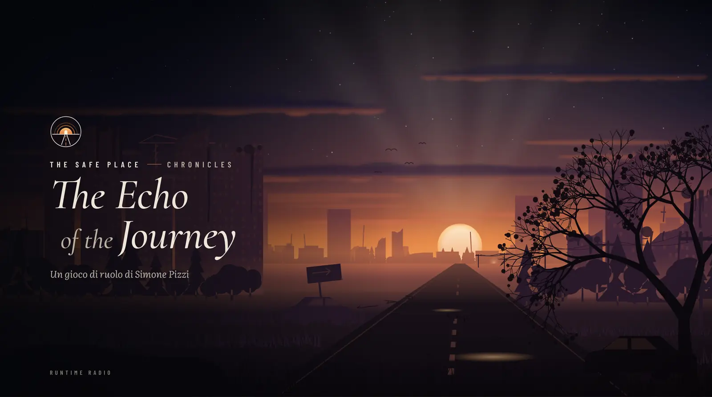

# The Safe Place Chronicles: The Echo of the Journey — il sito

*Ogni passo è un'eco. Ogni eco, una scelta.*



Landing page ufficiale del gioco, pubblicata su [thesafeplace.runtimeradio.it](https://thesafeplace.runtimeradio.it/):
presenta il gioco, la sua storia e lo sviluppo, e distribuisce gli installer della release pubblica.

## Cos'è The Safe Place Chronicles?

**The Safe Place Chronicles** è un gioco di ruolo narrativo di sopravvivenza in un'Europa post-apocalittica: un viaggio
a piedi verso l'ultimo luogo sicuro. Ultimo si sveglia nel rifugio e suo padre non c'è più: gli ha lasciato una lettera e
una vecchia mappa che porta a Est, verso un luogo chiamato The Safe Place.

Nato come esperimento tecnico e narrativo, è stato sviluppato da Simone Pizzi in simbiosi creativa con il supporto di
modelli linguistici (LLM). Si gioca da tastiera ed è un'applicazione desktop **gratuita e open source** per Windows,
macOS e Linux (React + Ink + Electron). *Dalla 3.1.0 le release ufficiali includono solo Windows e Linux; i testi del sito vanno allineati alla pubblicazione.*

## Caratteristiche principali del gioco

| Funzionalità | Descrizione |
| :--- | :--- |
| **Un mondo vivo** | Una vasta mappa con biomi unici (pianure, foreste, città), meteo e ciclo del giorno e della notte. |
| **Sopravvivenza impegnativa** | Fame, sete e salute, stati come ferite, malattie e avvelenamento, equipaggiamento che si consuma. |
| **Una storia a strati** | Una trama principale in 12 capitoli che si svela giocando, eventi a tema, Easter Egg e cutscene. |
| **Crescita e scelte morali** | Talenti da scegliere salendo di livello; le decisioni orientano la Bussola Interiore (Lena/Elian). |
| **Combattimento tattico** | Scontri a turni raccontati; analizza il nemico per scoprirne le debolezze, usa l'ambiente. |
| **Crafting progressivo** | Manuali e schemi da trovare lungo la strada per imparare nuove ricette. |

## Identità visiva (2.0 del sito)

Il sito usa la stessa identità visiva del gioco dalla versione 3.0 (direzione artistica in
[`../COVER-UFFICIALE/README.md`](../COVER-UFFICIALE/README.md)): illustrazione vettoriale al crepuscolo, un solo accento
color brace, tipografia editoriale. Niente più terminale, fosfori verdi o effetti CRT.

- **Palette e componenti** (`src/index.css`, `tailwind.config.js`): gli stessi colori del tema *Crepuscolo* del gioco,
  come triplette RGB (`bg-ember/20`), con pannelli di vetro, pulsanti e animazioni del menu (carrellata sulla key art,
  cenere nell'aria). Le animazioni si fermano con `prefers-reduced-motion`.
- **Font** (`public/fonts`, licenza SIL OFL, gli stessi di `GAME/src/assets/fonts`): Cormorant Garamond per i titoli,
  Literata per i testi narrativi, Barlow e Barlow Condensed per l'interfaccia. Sono inclusi nel sito: la pagina non fa
  richieste esterne (il teaser di YouTube si carica solo quando si preme play).
- **Logo, emblema e icone** (`src/components/Logo.tsx`, `src/components/Icon.tsx`): ripresi dal gioco.
- **Immagini** (`public/image`): key art, copertine, poster e immagine Open Graph (1200×630), più le favicon in
  `public/`. Si rigenerano tutte dalla grafica ufficiale con lo script qui sotto.

### Rigenerare le immagini

```bash
cd GAME && npm run dev                      # in un altro terminale: le composizioni di GAME/preview.html
cd SITO && node scripts/export-images.mjs   # richiede ImageMagick e Playwright (npm i -D playwright)
```

Lo script ridimensiona in WebP le immagini di `COVER-UFFICIALE/` (hero, galleria) e cattura da `GAME/preview.html`
l'immagine Open Graph (`art=cover-landscape`) e le favicon (`art=icon`).

## Log sviluppo principali

- **v1.3.1 - The Survival Overhaul:** Introduzione della 'Ricerca Attiva' e revisione del loot.
- **v1.5.0 - Quest System Framework:** Implementazione di un'infrastruttura completa per missioni.
- **v1.7.0 - Social Hub & Interactive NPCs:** Il mondo si popola con PNG interattivi e alberi di dialogo.
- **v1.9.1 - Tactical Combat:** Il combattimento si evolve con azioni ambientali contestuali.
- **v1.9.5 - Content Expansion:** Aggiunta di quest, eventi e oggetti unici che arricchiscono la narrativa.
- **v2.0.0 - Golden Master Release:** Il progetto raggiunge la sua forma definitiva; tutti i sistemi stabili e testati.
- **v2.0.14 - Campagna di Chiusura:** Audit completo e revisione dei sistemi; il gioco è completabile fino al finale.
- **v2.0.16 - Rilascio Desktop Open Source:** App desktop Electron per Windows, macOS e Linux, con build via CI e release pubblica su GitHub.
- **v2.0.17 - Rifiniture Desktop:** Installer NSIS per Windows, avvio a schermo intero, nuova icona ufficiale e miglioramenti alle cutscene.
- **v2.1.0 - Revisione Completa** *(prossima release)*: trama e quest completabili, test automatici che giocano il gioco.
- **v3.0.0 - Nuova Identità Visiva** *(prossima release)*: dal terminale al gioco narrativo, interfaccia, mappa, logo e copertine nuovi.

## Come eseguire il sito

```bash
npm ci            # dipendenze
npm run dev       # server di sviluppo
npm run build     # build di produzione in dist/
npm run preview   # anteprima della build
```

Il deploy **non è più automatico** (sospeso il 2026-10-22): `.github/workflows/deploy-site.yml` builda e pubblica `dist/` solo se avviato a mano da Actions → *Run workflow*. Per ripristinare la pubblicazione a ogni push su `main` che tocca `SITO/` va rimesso il trigger `push` nel workflow.

## Gioca / Scarica

Il gioco è **open source** e scaricabile gratuitamente per Windows e Linux dalla release pubblica su GitHub (ultima: v3.1.0):

- **Release e download:** [github.com/Pitz72/TheSafePlace-React/releases](https://github.com/Pitz72/TheSafePlace-React/releases)
- **Codice sorgente:** [github.com/Pitz72/TheSafePlace-React](https://github.com/Pitz72/TheSafePlace-React)
